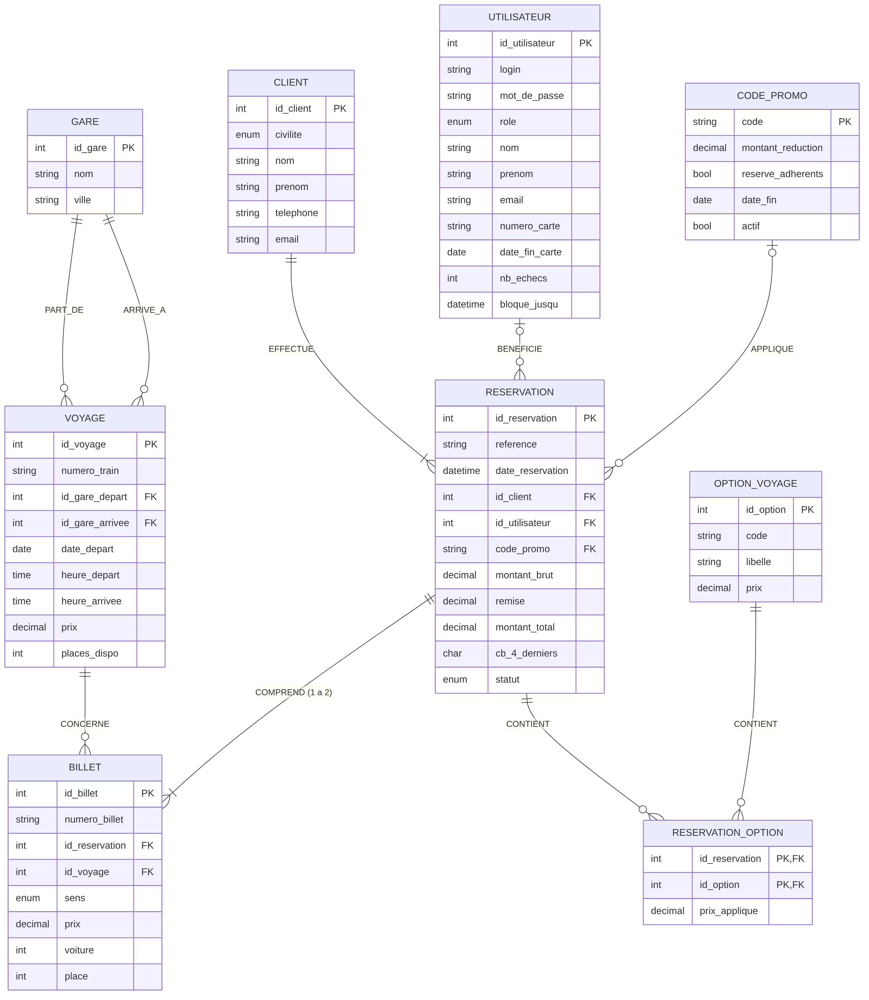

# Modèle Conceptuel de Données (MCD)

**Projet :** portail de réservation de billets de TGV « europe.transports »
**Enseignant :** L. TRAN — Projet Agile 3AE, ECAM-EPMI

## 1. Entités

| Entité | Rôle | Attributs (identifiant souligné) |
|---|---|---|
| **GARE** | Gare desservie | <u>id_gare</u>, nom, ville |
| **VOYAGE** | Une circulation de TGV à une date et une heure, avec son prix (source du calendrier des prix) | <u>id_voyage</u>, numero_train, date_depart, heure_depart, heure_arrivee, prix, places_dispo |
| **OPTION_VOYAGE** | Option payante (place tranquille, prise, bagage, SMS, garantie) | <u>id_option</u>, code, libelle, prix |
| **CLIENT** | Voyageur qui achète | <u>id_client</u>, civilite, nom, prenom, telephone, email |
| **RESERVATION** | Panier validé et payé | <u>id_reservation</u>, reference, date_reservation, montant_brut, remise, montant_total, cb_4_derniers, statut |
| **BILLET** | Billet d'un trajet (aller ou retour) | <u>id_billet</u>, numero_billet, sens, prix, voiture, place |
| **UTILISATEUR** | Compte géré par l'administrateur : administrateur ou adhérent (carte d'abonnement) | <u>id_utilisateur</u>, login, mot_de_passe (haché), role, civilite, nom, prenom, email, numero_carte, date_fin_carte, nb_echecs, bloque_jusqu |
| **CODE_PROMO** | Code de réduction (-10 €) | <u>code</u>, montant_reduction, reserve_adherents, date_fin, actif |

## 2. Associations et cardinalités

| Association | Entités | Cardinalités | Lecture |
|---|---|---|---|
| **PART_DE** | GARE — VOYAGE | GARE 0,n — VOYAGE 1,1 | Un voyage part d'une seule gare ; une gare est le départ de 0 à n voyages. |
| **ARRIVE_A** | GARE — VOYAGE | GARE 0,n — VOYAGE 1,1 | Un voyage arrive dans une seule gare. |
| **EFFECTUE** | CLIENT — RESERVATION | CLIENT 1,n — RESERVATION 1,1 | Une réservation est faite par un seul client. |
| **COMPREND** | RESERVATION — BILLET | RESERVATION 1,2 — BILLET 1,1 | Une réservation comprend 1 billet (aller simple) ou 2 billets (aller/retour). |
| **CONCERNE** | VOYAGE — BILLET | VOYAGE 0,n — BILLET 1,1 | Un billet concerne un seul voyage. |
| **CONTIENT** *(porteuse : prix_applique)* | RESERVATION — OPTION_VOYAGE | RESERVATION 0,n — OPTION 0,n | Une réservation contient 0 à 5 options ; on garde le prix payé. |
| **BENEFICIE** | UTILISATEUR — RESERVATION | UTILISATEUR 0,n — RESERVATION 0,1 | Un adhérent peut rattacher ses réservations à sa carte d'abonnement. |
| **APPLIQUE** | CODE_PROMO — RESERVATION | CODE_PROMO 0,n — RESERVATION 0,1 | Une réservation utilise au plus un code promo. |

## 3. Modèle Logique de Données (MLD)

Clés primaires soulignées, clés étrangères précédées de #.

- GARE (<u>id_gare</u>, nom, ville)
- VOYAGE (<u>id_voyage</u>, numero_train, #id_gare_depart, #id_gare_arrivee, date_depart, heure_depart, heure_arrivee, prix, places_dispo)
- OPTION_VOYAGE (<u>id_option</u>, code, libelle, prix)
- UTILISATEUR (<u>id_utilisateur</u>, login, mot_de_passe, role, civilite, nom, prenom, email, numero_carte, date_fin_carte, nb_echecs, bloque_jusqu, date_creation)
- CODE_PROMO (<u>code</u>, montant_reduction, reserve_adherents, date_fin, actif)
- CLIENT (<u>id_client</u>, civilite, nom, prenom, telephone, email)
- RESERVATION (<u>id_reservation</u>, reference, date_reservation, #id_client, #id_utilisateur, #code_promo, montant_brut, remise, montant_total, cb_4_derniers, statut)
- BILLET (<u>id_billet</u>, numero_billet, #id_reservation, #id_voyage, sens, prix, voiture, place)
- RESERVATION_OPTION (<u>#id_reservation, #id_option</u>, prix_applique)

## 4. Règles de gestion

1. Le prix d'un billet dépend de la date et de l'heure du voyage : le calendrier des prix affiche, pour chaque jour, le prix le plus bas.
2. Les options sont facturées une fois par réservation. La garantie annulation (2,90 €) couvre l'aller et le retour.
3. La réduction de 10 € n'est accordée qu'avec une carte d'abonnement valide **et** un code promo actif et non expiré.
4. Le montant total = billets + options − remise.
5. Sécurité : seuls les 4 derniers chiffres de la carte bancaire sont enregistrés. Le cryptogramme n'est jamais stocké.
6. Les mots de passe sont hachés (bcrypt). Après 2 échecs de connexion, un avertissement s'affiche ; au 3ᵉ échec, le compte est bloqué 5 minutes.

## 5. Vérification avec le scénario du Product Owner

| Élément | Montant |
|---|---:|
| Aller Paris Gare de Lyon → Lyon Part-Dieu, 07/12/2026 à 8h | 45,00 € |
| Retour Lyon Part-Dieu → Paris Gare de Lyon, 15/12/2026 à 10h | 49,00 € |
| Place tranquille + prise + bagage + SMS + garantie | 3 + 2 + 5 + 1 + 2,90 = 13,90 € |
| Réduction adhérent (code promo) | −10,00 € |
| **Total payé** | **97,90 €** |
